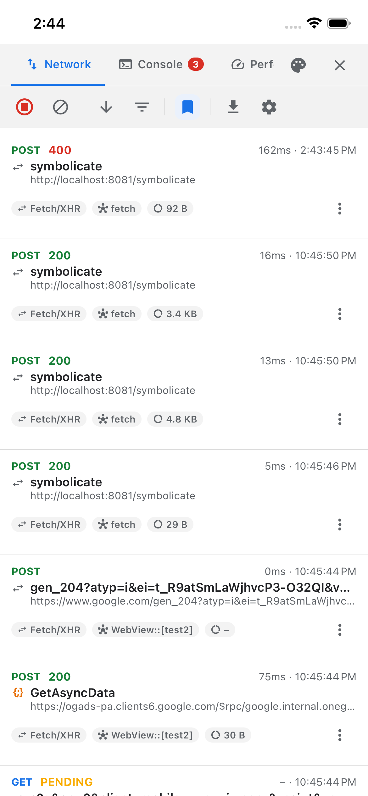
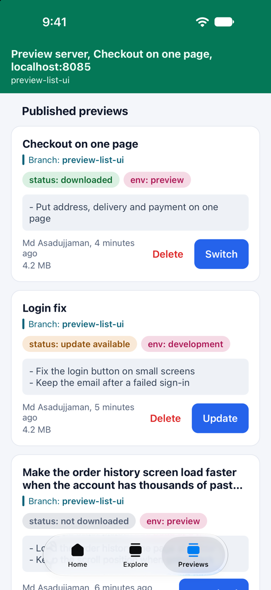
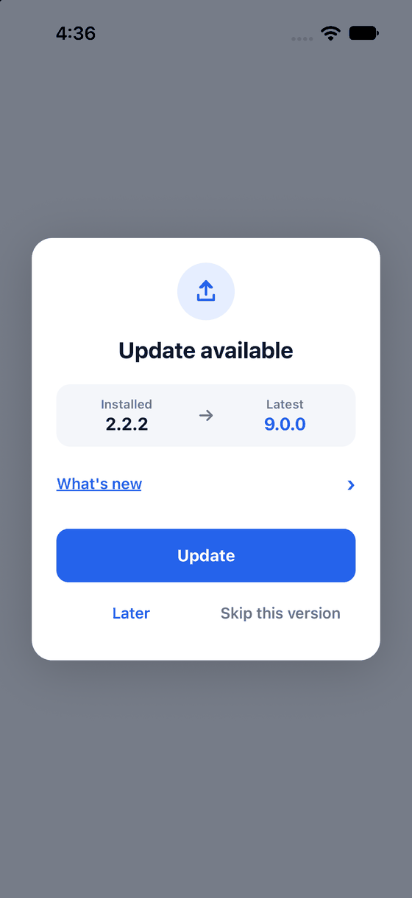
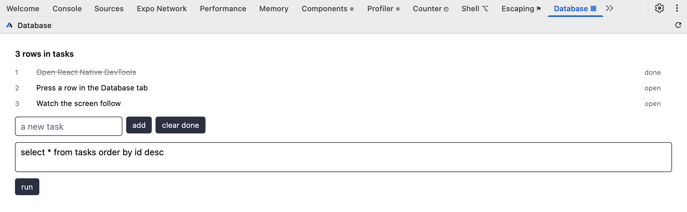
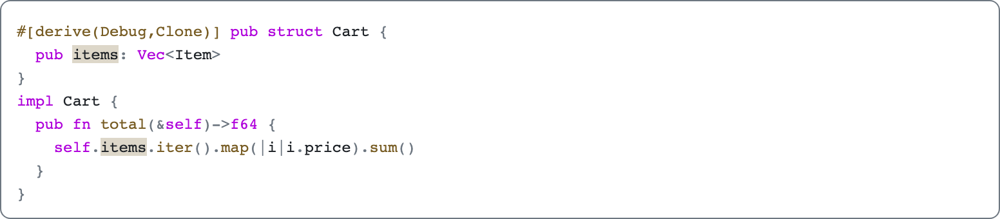

<div align="center">


# Axonpack

Axonpack is a set of free, open-source libraries for React Native and Expo apps, each published on
npm as its own `@axonpack/*` package. They cover in-app devtools that an AI agent can also read from
a terminal, your own tabs in React Native DevTools, JSON and code viewers, store update prompts, and
JS previews of a branch inside a build you already installed.

**[Documentation](https://axonpack.dev/docs)** · [Board](https://github.com/orgs/axonpack/projects/1)

[](./LICENSE)
[](https://www.conventionalcommits.org)
[](./CONTRIBUTING.md)

<table>
  <tr>
    <td width="33%" valign="top"></td>
    <td width="33%" valign="top"></td>
    <td width="33%" valign="top"></td>
  </tr>
  <tr>
    <td><code>@axonpack/expo-devtools</code>: the Network tab on the device.</td>
    <td><code>@axonpack/preview</code>: the previews published for this build.</td>
    <td><code>@axonpack/in-app-updates</code>: the default update prompt.</td>
  </tr>
  <tr>
    <td colspan="3"></td>
  </tr>
  <tr>
    <td colspan="3"><code>@axonpack/react-native-devtools-tab</code>: a tab that lists the app's SQLite rows and runs your query on the device.</td>
  </tr>
  <tr>
    <td colspan="3"></td>
  </tr>
  <tr>
    <td colspan="3"><code>@axonpack/react-pretty-print</code>: Rust, one of 38 languages, with the matches for a search marked.</td>
  </tr>
</table>

</div>

## Packages

Each package is published to npm and versioned on its own, so you install only the ones you need.
`@axonpack/expo-devtools` brings `@axonpack/react-pretty-print` and
`@axonpack/react-native-devtools-tab` with it as dependencies.

| Package                                                                                                                                                 | Description                                                                                                            | Version                                                                                                                                           | Downloads                                                                                                                                                |
| ------------------------------------------------------------------------------------------------------------------------------------------------------- | ---------------------------------------------------------------------------------------------------------------------- | ------------------------------------------------------------------------------------------------------------------------------------------------- | -------------------------------------------------------------------------------------------------------------------------------------------------------- |
| [`@axonpack/expo-devtools`](./packages/@axonpack/expo-devtools)<br/>[Docs](https://axonpack.dev/docs/expo-devtools)                                     | On-device network, console, performance, storage, navigation and crash devtools, readable by AI agents from a terminal | [](https://www.npmjs.com/package/@axonpack/expo-devtools)                         | [](https://www.npmjs.com/package/@axonpack/expo-devtools)                         |
| [`@axonpack/react-native-devtools-tab`](./packages/@axonpack/react-native-devtools-tab)<br/>[Docs](https://axonpack.dev/docs/react-native-devtools-tab) | Your own tab in React Native DevTools, drawn from a component that runs in the app                                     | [](https://www.npmjs.com/package/@axonpack/react-native-devtools-tab) | [](https://www.npmjs.com/package/@axonpack/react-native-devtools-tab) |
| [`@axonpack/react-pretty-print`](./packages/@axonpack/react-pretty-print)<br/>[Docs](https://axonpack.dev/docs/react-pretty-print)                      | Collapsible JSON and XML trees and a syntax highlighter, for React and React Native from one implementation            | [](https://www.npmjs.com/package/@axonpack/react-pretty-print)               | [](https://www.npmjs.com/package/@axonpack/react-pretty-print)               |
| [`@axonpack/in-app-updates`](./packages/@axonpack/in-app-updates)<br/>[Docs](https://axonpack.dev/docs/in-app-updates)                                  | Store version checks, force updates and a ready-made update modal for React Native and Expo                            | [](https://www.npmjs.com/package/@axonpack/in-app-updates)                       | [](https://www.npmjs.com/package/@axonpack/in-app-updates)                       |
| [`@axonpack/preview`](./packages/@axonpack/preview)<br/>[Docs](https://axonpack.dev/docs/preview)                                                       | Publish a JS bundle per branch and switch to it in the installed app, with no native rebuild                           | [](https://www.npmjs.com/package/@axonpack/preview)                                     | [](https://www.npmjs.com/package/@axonpack/preview)                                     |

### @axonpack/expo-devtools

A floating button opens a devtools panel on the device, with tabs for Network, Console, Performance,
Storage, Crashes, CLI and Debug, plus Query, Navigation and Redux when the app uses them. A support
connects it to another package from its own entry point: `@axonpack/expo-devtools/support/preview/v0`
sets up `@axonpack/preview` and adds a Preview tab. The `devtools` command line tool reads the same data
from a terminal (see [AI coding agents](#ai-coding-agents)). With `enabled` off nothing is patched or
recorded, so the provider can stay in a release build.

```sh
npx expo install @axonpack/expo-devtools react-native-safe-area-context react-native-webview expo-clipboard
```

```tsx
// devtools.ts
import type { DevtoolsConfig } from "@axonpack/expo-devtools";

export const devtoolsConfig = {
  enabled: process.env.EXPO_PUBLIC_APP_ENV !== "prod",
} satisfies DevtoolsConfig;

// App.tsx
import { DevtoolsProvider } from "@axonpack/expo-devtools";
import { devtoolsConfig } from "./devtools";

export default function App() {
  return (
    <DevtoolsProvider config={devtoolsConfig}>
      <YourApp />
    </DevtoolsProvider>
  );
}
```

[Installation](https://axonpack.dev/docs/expo-devtools/installation) · [Quick start](https://axonpack.dev/docs/expo-devtools/quick-start) · [Supports](https://axonpack.dev/docs/expo-devtools/supports) · [Production](https://axonpack.dev/docs/expo-devtools/production) · [Changelog](https://axonpack.dev/docs/expo-devtools/changelog)

### @axonpack/react-native-devtools-tab

This package adds your own tab to React Native DevTools, beside Console and Sources. The tab is a
React component that runs in the app, so it reads the app's own state, and a button in it calls the
app's own functions. Setup is one wrapper in `metro.config.js` and a file that registers the tab in
development.

```sh
npm install @axonpack/react-native-devtools-tab
```

```tsx
// devtools.tsx
import { useState } from "react";
import { ReactNativeDevtoolsPanel } from "@axonpack/react-native-devtools-tab";

function Session() {
  const [count, setCount] = useState(0);

  return (
    <div style={{ padding: 12 }}>
      <p>pressed {count} times</p>
      <button onClick={() => setCount(count + 1)}>press</button>
    </div>
  );
}

ReactNativeDevtoolsPanel.registerTab({
  name: "Session",
  icon: "\u269b",
  component: Session,
});
```

[Installation](https://axonpack.dev/docs/react-native-devtools-tab/installation) · [Quick start](https://axonpack.dev/docs/react-native-devtools-tab/quick-start) · [Production](https://axonpack.dev/docs/react-native-devtools-tab/production) · [Reference](https://axonpack.dev/docs/react-native-devtools-tab/reference) · [Changelog](https://axonpack.dev/docs/react-native-devtools-tab/changelog)

### @axonpack/react-pretty-print

This package draws collapsible JSON and XML trees and highlighted code, for React and React Native
from one implementation. You pass in the container, text and pressable components, and it owns the
rest: expansion state, array chunking, collapsed-node previews, an XML parser, a 38-language
tokenizer and 130 palettes. It has no dependencies and no native module, so it runs in Expo Go, and
on the web it ships `domPrimitives` for you.

```sh
npm install @axonpack/react-pretty-print
```

```tsx
import { Pressable, Text, View } from "react-native";
import { JsonTree } from "@axonpack/react-pretty-print";

const Example = () => (
  <JsonTree primitives={{ View, Text, Pressable }} value={response} />
);
```

[Installation](https://axonpack.dev/docs/react-pretty-print/installation) · [Primitives](https://axonpack.dev/docs/react-pretty-print/primitives) · [JSON tree](https://axonpack.dev/docs/react-pretty-print/json-tree) · [Reference](https://axonpack.dev/docs/react-pretty-print/reference) · [Changelog](https://axonpack.dev/docs/react-pretty-print/changelog)

### @axonpack/in-app-updates

This package checks the App Store or Play Store for a newer version of your app and opens a
ready-made update prompt. It handles soft and forced updates, skipping a version, light and dark
mode, your own modal, and faking a release in a development build. The checks are plain JavaScript
and run in Expo Go.

```sh
npx expo install @axonpack/in-app-updates expo-application expo-localization
```

```tsx
import { UpdatePrompt } from "@axonpack/in-app-updates";
import { Text, View } from "react-native";

export default function App() {
  return (
    <View style={{ flex: 1 }}>
      <Text>My app</Text>
      <UpdatePrompt />
    </View>
  );
}
```

[Installation](https://axonpack.dev/docs/in-app-updates/installation) · [Quick start](https://axonpack.dev/docs/in-app-updates/quick-start) · [The update modal](https://axonpack.dev/docs/in-app-updates/modal) · [Reference](https://axonpack.dev/docs/in-app-updates/reference) · [Changelog](https://axonpack.dev/docs/in-app-updates/changelog)

### @axonpack/preview

This package publishes a JS bundle per branch to your own S3-compatible bucket, such as AWS S3,
Cloudflare R2 or MinIO, and QA switches to it in the build they already have, with no native
rebuild. `npx preview publish` builds and uploads the current branch, and each app's previews go in a
folder named after its Expo slug, so several apps can share one bucket. With `devPreviewServers` on,
a debug build also lists each Metro started with `npx preview start`, one per worktree, and switches
between them live. It has native code and a config plugin, so it runs in a development or release
build and doesn't run in Expo Go.

```sh
npx expo install @axonpack/preview expo-file-system
```

```tsx
import { PreviewList, PreviewProvider } from "@axonpack/preview";

export default function App() {
  return (
    <PreviewProvider
      config={{
        enabled: true,
        s3Config: { url: process.env.EXPO_PUBLIC_PREVIEW_S3_URL as string },
      }}
    >
      <PreviewList style={{ flex: 1 }} />
    </PreviewProvider>
  );
}
```

[Installation](https://axonpack.dev/docs/preview/installation) · [Quick start](https://axonpack.dev/docs/preview/quick-start) · [Dev preview servers](https://axonpack.dev/docs/preview/dev-preview-servers) · [CI](https://axonpack.dev/docs/preview/ci) · [CLI](https://axonpack.dev/docs/preview/cli) · [Changelog](https://axonpack.dev/docs/preview/changelog)

## AI coding agents

One agent skill, `axonpack`, covers every package. Run this in your app's project folder:

| Package manager | Command                               |
| --------------- | ------------------------------------- |
| npm             | `npx skills add axonpack/skills`      |
| yarn            | `yarn dlx skills add axonpack/skills` |
| pnpm            | `pnpm dlx skills add axonpack/skills` |
| bun             | `bunx skills add axonpack/skills`     |

The skill has no setup steps of its own. It sends the agent to the live docs, starting from
[`https://axonpack.dev/llms.txt`](https://axonpack.dev/llms.txt), and has it follow the
[agent guide](https://axonpack.dev/docs/agent-guide), so it always matches the latest release of each
package.

`@axonpack/expo-devtools` also installs `devtools`, a command line tool that reads what the running
app recorded: requests with their headers and bodies, the console, crashes, stored values and the
other tabs. It can mock or block a URL and send a request from inside the app too. It needs Node 22
or newer, the app open in a dev build or Expo Go, and `expo start` running.

```sh
npx devtools network --where state=error --since 10m
```

[Agent skill](https://axonpack.dev/docs/agent-skills) · [Agent guide](https://axonpack.dev/docs/agent-guide) · [Use with AI agents](https://axonpack.dev/docs/expo-devtools/ai-agents) · [devtools CLI reference](https://axonpack.dev/docs/expo-devtools/reference/cli)

## Repository layout

A [Turborepo](https://turborepo.dev) + [Bun workspaces](https://bun.sh/docs/install/workspaces)
monorepo.

```
packages/@axonpack/*   published libraries, one folder each
packages/linter        shared oxlint base config, internal and deliberately unscoped
docs                   the documentation site and landing page, with its own install
```

`docs` is not a workspace member, so the root `install`, `build`, `lint` and `check-types` all skip
it. Run `bun install` inside `docs/` to work on it.

## Development

Bun only, pinned via `devEngines.packageManager` (Bun 1.3.14, Node >= 24).

```sh
git clone https://github.com/axonpack/axonpack.git
cd axonpack
bun install
```

`marketing/` is a private submodule set to `update = none`, so clones and the Cloudflare build skip
it. With access, fetch it with
`git -c submodule.marketing.update=checkout submodule update --init marketing`.

| Command               | What it does                                             |
| --------------------- | -------------------------------------------------------- |
| `bun run build`       | `turbo run build` across every workspace that defines it |
| `bun run lint`        | `turbo run lint` (oxlint)                                |
| `bun run check-types` | `turbo run check-types` (`tsc --noEmit`)                 |
| `bun run test`        | `turbo run test` (jest and `bun test`)                   |
| `bun run format`      | Prettier over the repo                                   |
| `bun run dev:docs`    | Start the documentation site                             |
| `bun run changeset`   | Record a release note for a change                       |

Run `bun install` from the repository root, not from inside a package: Bun's workspace linking
depends on the root lockfile.

See [`CONTRIBUTING.md`](./CONTRIBUTING.md) for the full workflow, coding conventions, commit format,
and how to run a package's example app.

## Releases

Every change that should reach npm carries a changeset (`bun run changeset`). After that it is
automatic:

1. A PR merges into `main`. While changesets are pending there, two jobs run at once. One publishes
   a canary of every package with a changeset under the `canary` dist-tag, as
   `<next version>-canary-<commit>`. The other opens or refreshes the Version Packages PR with the
   version bumps and the changelog.
2. More PRs merge. Each one publishes a fresh canary and brings the Version Packages PR up to date,
   so it always describes what is on `main`.
3. A maintainer merges the Version Packages PR. That is the release: it leaves no changesets behind,
   so the packages are published to `latest`, tagged, and given a GitHub Release each. Nothing else
   publishes to `latest`.

Try a canary with `bun add @axonpack/expo-devtools@canary`. To try a PR before it merges, add the
`preview` label and CI posts an install link from pkg.pr.new on the PR; npm is not involved.

Publishing uses npm trusted publishing, so the workflow holds no npm token, and every version it
publishes carries a provenance attestation you can check with `npm audit signatures`.

## Contributing

Bug reports, docs fixes and PRs are welcome. Please read [`CONTRIBUTING.md`](./CONTRIBUTING.md) and
our [Code of Conduct](./CODE_OF_CONDUCT.md) first.

What is planned and what is in progress is on the
[Axonpack board](https://github.com/orgs/axonpack/projects/1), grouped by
[milestone](https://github.com/axonpack/axonpack/milestones). Pick anything there that is not
already claimed.

## License

MIT © [Md Asadujjaman](https://github.com/abappi19). See [`LICENSE`](./LICENSE).
