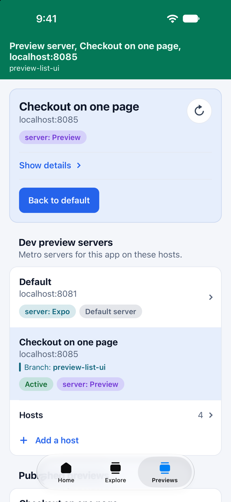
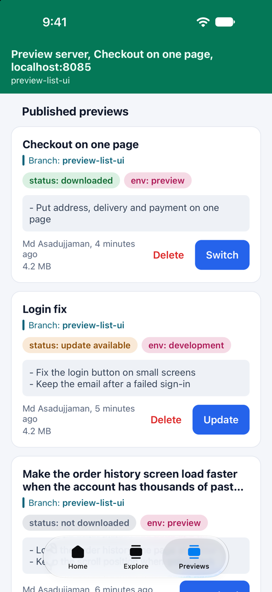

<div align="center">


# @axonpack/preview

**Preview every pull request of your Expo app over the air, from your own S3-compatible bucket.**

Publish a JS bundle per branch, called a preview, to your own bucket on AWS S3, Cloudflare R2, MinIO
or any host with the S3 API. The app lists the previews made for its native build. Pick one from the
ready-made list or a screen of your own, and it downloads and runs after a restart, with no native
rebuild or new install. Going back to the default bundle is one tap.

**[Documentation](https://axonpack.dev/docs/preview)** · [Quick start](https://axonpack.dev/docs/preview/quick-start) · [CLI](https://axonpack.dev/docs/preview/cli) · [Changelog](https://axonpack.dev/docs/preview/changelog)

[](https://www.npmjs.com/package/@axonpack/preview)
[](https://www.npmjs.com/package/@axonpack/preview)
[](https://github.com/axonpack/axonpack/blob/main/LICENSE)

<table>
  <tr>
    <td width="50%"></td>
    <td width="50%"></td>
  </tr>
  <tr>
    <td>What runs now, and every Metro server for the app, switched with a tap.</td>
    <td>The previews for this build, with their state, environment and changelog.</td>
  </tr>
</table>

</div>

## Installation

```sh
npx expo install @axonpack/preview expo-file-system
```

It needs React Native's New Architecture, which means Expo SDK 53 or later. Under the old
architecture the package logs one warning and always loads the default bundle, so the app still
starts. It has native code, so it runs in a development or release build, not in Expo Go.

## Setup

Add the config plugin to `app.json`, then run a prebuild or a new native build:

```json
{
  "expo": {
    "plugins": [["@axonpack/preview", { "compatibility": "appVersion" }]]
  }
}
```

The plugin bakes a key into the build. The app lists only previews published under that key.
It also bakes in the app's slug: each app's previews go in a folder named after it, so several apps
can share one bucket.
`appVersion` (the default) keys on the app version; `fingerprint` keys on the native fingerprint.

Wrap the app in the provider and put the list on a screen QA can reach:

```tsx
import { PreviewList, PreviewProvider } from "@axonpack/preview";

export default function App() {
  return (
    <PreviewProvider
      config={{
        enabled: true,
        s3Config: { url: process.env.EXPO_PUBLIC_PREVIEW_S3_URL as string },
      }}
    >
      <PreviewList style={{ flex: 1 }} />
    </PreviewProvider>
  );
}
```

`PreviewList` is a plain component, so it can also go in a tab, a stack screen, a `Modal` or a
bottom sheet, anywhere under the provider. See
[Show the list anywhere](https://axonpack.dev/docs/preview/app-setup#show-the-list-anywhere).

With [`@axonpack/expo-devtools`](https://axonpack.dev/docs/expo-devtools), skip the provider: pass the
same config through `@axonpack/expo-devtools/support/preview/v0` (the support for 0.x), and the
devtools mount the provider, show the list in a Preview tab, and add a `preview` topic to their
command line tool for switching, downloading and deleting previews from a terminal. The config plugin is still yours to add. See
[With expo-devtools](https://axonpack.dev/docs/preview/app-setup#with-expo-devtools).

Publish the current branch from the app's root. The bucket and the write key come from the
environment, or from a gitignored `.env.local`:

```sh
PREVIEW_S3_URL=https://<account>.r2.cloudflarestorage.com/previews \
PREVIEW_S3_ACCESS_KEY_ID=... PREVIEW_S3_SECRET_ACCESS_KEY=... \
npx preview publish
```

The write key is for publishing only. Never put it in the app: the app gets the bucket's public
address, or a read-only key for a private bucket.

Publish builds in a copy of the project in a temp folder, like an EAS build: the copy gets its own
install and runs your `eas-build-pre-install` and `eas-build-post-install` scripts with
`PREVIEW_PUBLISH=1`, and your folder isn't written to. `--in-place` builds in the folder instead,
which is faster and is what the CI samples use. See
[Publishing](https://axonpack.dev/docs/preview/publishing#what-publish-does).

A folder that ships beside the JS, such as the web app a WebView shows, can go with each preview.
Name it in the plugin's `files` option, and `usePreviewFiles(name)` gives the copy that goes with
the running bundle. See [Files with a preview](https://axonpack.dev/docs/preview/files).

An [agent skill](https://axonpack.dev/docs/agent-skills) teaches your coding agent this package:
`npx skills add axonpack/skills`.

## Documentation

Everything else is on the docs site.

| Page                                                                         | What is on it                                                                                                |
| ---------------------------------------------------------------------------- | ------------------------------------------------------------------------------------------------------------ |
| [Quick start](https://axonpack.dev/docs/preview/quick-start)                 | From an empty bucket to switching previews in the app                                                        |
| [Storage](https://axonpack.dev/docs/preview/storage)                         | Public or private bucket, and the write and read keys                                                        |
| [AWS S3](https://axonpack.dev/docs/preview/aws-s3)                           | A bucket, a policy and both keys on AWS                                                                      |
| [Cloudflare R2](https://axonpack.dev/docs/preview/cloudflare-r2)             | A bucket, a public address and both keys on R2                                                               |
| [MinIO](https://axonpack.dev/docs/preview/minio)                             | Your own server on a VPS, or the local one for trying it out                                                 |
| [Settings and env files](https://axonpack.dev/docs/preview/environment)      | Where the publish settings and the app's settings come from, and EAS                                         |
| [Publishing](https://axonpack.dev/docs/preview/publishing)                   | Publish, replace, unpublish and prune                                                                        |
| [CI](https://axonpack.dev/docs/preview/ci)                                   | Publish every pull request with GitHub Actions                                                               |
| [Compatibility](https://axonpack.dev/docs/preview/compatibility)             | The config plugin, and app version or fingerprint                                                            |
| [App setup](https://axonpack.dev/docs/preview/app-setup)                     | The provider, the list and its theme, your own screen, and the status                                        |
| [Files with a preview](https://axonpack.dev/docs/preview/files)              | A folder, such as a WebView's web app, published with each preview, and its path in the app                  |
| [Dev preview servers](https://axonpack.dev/docs/preview/dev-preview-servers) | Several Metro servers, one per worktree or computer, found on the network and switched live in a debug build |
| [expo-updates](https://axonpack.dev/docs/preview/expo-updates)               | How previews sit on top of a build that expo-updates manages                                                 |
| [Troubleshooting](https://axonpack.dev/docs/preview/troubleshooting)         | An empty list, a failed download, and what to check                                                          |
| [CLI](https://axonpack.dev/docs/preview/cli)                                 | Every command and option                                                                                     |
| [Reference](https://axonpack.dev/docs/preview/reference)                     | Every export, config field, label and theme token                                                            |
| [Changelog](https://axonpack.dev/docs/preview/changelog)                     | Every published release, also in [`CHANGELOG.md`](./CHANGELOG.md)                                            |

## Example app

`example/` is the default `create-expo-app` template with the list on a Previews tab and a banner
on every tab that says what runs. Its Home tab reads `web/content.json` from the copy that goes with
the running bundle, so a preview published with a changed file shows the change. It publishes to a
local MinIO, so it needs no cloud account:

```sh
bun run storage:local                       # MinIO in Docker or Podman
cp example/.env.example example/.env
cp example/.env.local.example example/.env.local
cd example && npx expo run:ios              # or: npx expo run:android
bun run publish:preview --id task-1-login-fix
```

The whole run, with the device setup for each platform, is in
[the testing note](https://github.com/axonpack/axonpack/blob/main/packages/@axonpack/preview/notes/testing.md).

## What's built, and what isn't

See [the feature list](https://github.com/axonpack/axonpack/blob/main/packages/@axonpack/preview/notes/README.md) for what's built, what the platform genuinely can't do (and why this
doesn't fake it), and what's still on the table.
